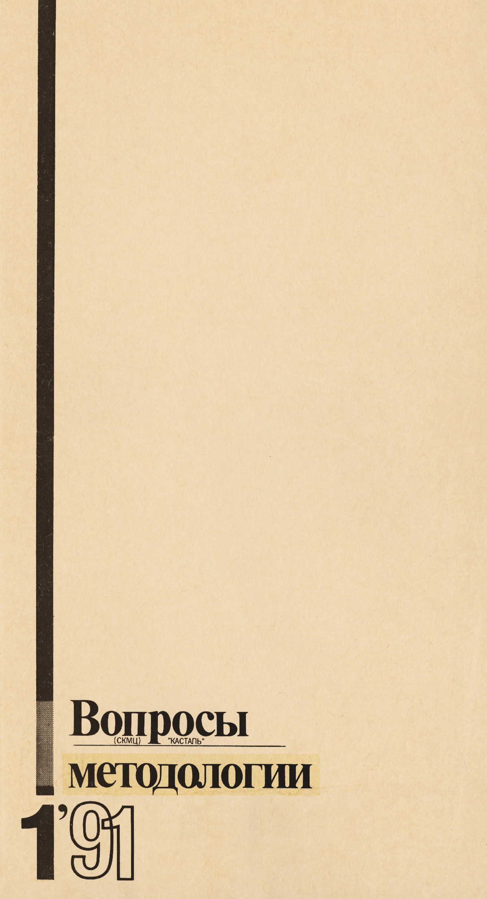

<div align="center">

# 📖 Вопросы методологии


**Архив журнала «Вопросы методологии» (1991–1999): сканы страниц, OCR-тексты и содержание выпусков**

</div>

> Журнал методологического сообщества, основанный Г. П. Щедровицким. Орган Комитета по системомыследеятельностной методологии и организационно-деятельностным играм. Публиковал работы Московского методологического кружка (ММК) и смежных направлений: теория деятельности, СМД-методология, педагогика, ОДИ, системный подход, герменевтика.

<div align="center">
  
  <br><br>
  <a href="#-содержание-архива">Содержание</a> · <a href="#-просмотр">Просмотр</a> · <a href="#-структура">Структура</a>
</div>

---

## 📦 Содержание архива

| Год | Выпуск | Страниц (JPEG) | Статей |
|-----|--------|----------------|--------|
| 1991 | № 1 | 114 | 15 |
| 1991 | № 2 | 114 | 13 |
| 1991 | № 3 | 118 | 9 |
| 1991 | № 4 | 114 | 10 |
| 1992 | № 1/2 | 178 | 14 |
| 1992 | № 3/4 | 162 | 12 |
| 1994 | № 1/2 | 162 | 13 |
| 1994 | № 3/4 | 178 | 11 |
| 1995 | № 1/2 | 130 | 12 |
| 1996 | № 1/2 | 130 | 18 |
| 1996 | № 3/4 | 178 | 5 |
| 1997 | № 1/2 | 162 | 13 |
| 1997 | № 3/4 | 178 | 14 |
| 1998 | № 1/2 | 178 | 18 |
| 1999 | № 1/2 | 178 | 10 |

| | **15 выпусков** | **2274** | **187** |

> [!NOTE]
> 1993 год отсутствует — в этот год журнал не выходил.

---

## 👁️ Просмотр

Каждый выпуск содержит:

- **JPEG-сканы** страниц (1200×2168 px) в папке выпуска
- **OCR-текст** — `pages.html` (полный текст выпуска, извлечённый автоматически)
- **Метаданные** — `meta.html` (содержание номера: рубрики, авторы, страницы)
- **Содержание в Markdown** — `voprosy_metodologii_YYYY_N.md` в корне репозитория

<details>
<summary>📋 Пример: как найти статью</summary>

1. Откройте `voprosy_metodologii_1991_3.md` — увидите содержание выпуска
2. Найдите нужную статью и номер страницы
3. Откройте JPEG с соответствующим номером (файлы названы по номерам страниц: `0003.jpg`, `0004.jpg`…)
4. Или откройте `pages.html` для чтения OCR-текста

</details>

---

## 🏗️ Структура

```
voprosy-metodologii/
├── voprosy_metodologii_1991_1/
│   ├── 0000.jpg … 0113.jpg    (114 сканов)
│   ├── meta.html              (метаданные + содержание)
│   └── pages.html             (OCR-текст)
├── voprosy_metodologii_1991_2/
│   └── ...
├── ...
├── voprosy_metodologii_1999_1-2/
│   └── ...
├── voprosy_metodologii_1991_1.md   (содержание выпуска в MD)
├── voprosy_metodologii_1991_2.md
├── ...
├── voprosy_metodologii_1999_1-2.md
├── README.md
├── llms.txt
├── llms-full.txt
└── LICENSE
```

---

## 📄 License

[Maxim Osovsky](https://www.linkedin.com/in/osovsky/). Licensed under [CC BY-SA 4.0](https://creativecommons.org/licenses/by-sa/4.0/).

> Архив журнала. Авторские права на оригинальные тексты принадлежат их авторам. Оцифровка и подготовка архива — Maxim Osovsky.